# Jot

A 300KiB, vim-inspired Markdown scratchpad with inline images. It's single binary, local desktop app with no Electron or WebView dependencies. It's CPU efficient, loads instantly (<50ms) and uses less than 1MiB of memory on startup.

## Nine pages, no file management
With Jot, there are no files to manage, just 9 scratch pages that you switch between as needed. Why nine? Jot's focus is on working notes, not building an archive. This is more than enough to manage a few threads. Anything more permanent usually lands in a git repo or wiki anyway.



## Build and run (Linux, Wayland)

Jot runs in a Wayland session (GNOME, KDE Plasma, Hyprland, Sway and so on). There is no
X11 support.

You need a C compiler, Make, pkg-config, Python 3, and the Wayland, libxkbcommon and
wayland-protocols development packages:

| Distro | Packages |
|---|---|
| Arch | `base-devel python wayland libxkbcommon wayland-protocols` |
| Fedora | `gcc make pkgconf-pkg-config python3 wayland-devel libxkbcommon-devel wayland-protocols-devel` |
| Debian, Ubuntu | `build-essential pkg-config python3 libwayland-dev libxkbcommon-dev wayland-protocols` |

To read text in screenshots so search can find it, also install Tesseract and its English
data. It's optional, and everything else works without it.

| Distro | Packages |
|---|---|
| Arch | `tesseract tesseract-data-eng` |
| Fedora | `tesseract tesseract-langpack-eng` |
| Debian, Ubuntu | `tesseract-ocr` |

Build and run:

```sh
make
./.build/linux/jot
```

Install to `~/.local/bin/jot`, with a **Jot** launcher entry and icon:

```sh
make install
```

Make sure `~/.local/bin` is on your `PATH`. Run `make install` again to update; your pages
and settings are kept. The installed binary has its debug info stripped (about 190 KB).
`PREFIX` (default `~/.local`) changes where it goes, and `DESTDIR` adds a staging root for
packaging. `make clean` removes the build.

There is also an experimental Windows build; see
[Appendix: Windows (experimental)](#appendix-windows-experimental).

## Using Jot

Run `jot`. It opens on the page you were last using, in normal mode.

- `Alt+1` to `Alt+9` switch pages, and `Alt+0` or `:ls` lists them.
- Editing is Vim-style: normal, insert and visual modes, motions, operators, text
  objects, counts, registers, search and `:s`.
- Paste a screenshot or drop an image file to add it to the page.
- `:w` or `Ctrl+S` saves, and `:q` closes; Jot won't close with unsaved changes.
- `:help` shows a short card. `:set view=source`, `normal` or `reading` changes how
  Markdown is shown, and `:colorscheme` picks from five color schemes, each with light and
  dark backgrounds.

The [key reference](docs/keys.md) lists every key and command.

## File Organization

Your notes live in `~/Documents/jot` (`~/jot` if there is no Documents folder), or in
`$JOT_DIR` if you set it:

```
~/Documents/jot/
├── 1/
│   ├── jot.md                                  page 1, as plain Markdown
│   └── assets/
│       ├── 20261030-142211-a1b2c3d4.png        a screenshot
│       ├── 20261030-142211-a1b2c3d4.png.txt    its text, read by OCR
│       └── 20261030-142211-a1b2c3d4.png.tsv    word positions, for highlighting
├── 2/
…
└── 9/
```

A page's folder appears the first time you open that page. On Linux, Jot makes the folders
private (`0700`) and new files private (`0600`).

You can grep the folder, edit a `jot.md` in another editor, or keep it all in git. If you
edit a page elsewhere, Jot reloads it when you switch back, as long as you have no unsaved
typing in it. `:Ex` opens the page's folder in your file manager.

Settings (color scheme, view, font size, window size, line numbers) are kept in
`~/.config/jot/config`, and the last page and cursor positions in `~/.local/state/jot`.

## How it differs from Vim

Jot isn't meant to replace Vim or Neovim, but the keys and flow should feel the same:
motions, counts, operators, text objects, visual mode, `.` repeat, marks, named registers,
`/` search and `:s` all work. The main differences:

- `y`, `d` and `p` use the system clipboard, like `clipboard=unnamedplus`. Named registers
  work as in Vim.
- `Ctrl+V` pastes instead of starting block visual mode, which Jot doesn't have.
- Macros, `Ctrl-A`/`Ctrl-X`, insert-mode counts, `:g`, `:sort`, `:m`, `:t` and `:normal`
  aren't implemented.
- `:s` supports a small, Vim-like subset of regular expressions, so unusual patterns may
  behave differently.
- There's no vimrc or plugins.

## Development

```sh
make test          # unit and integration tests
make format        # apply .clang-format (make format-check to check)
make windows       # check the Windows build still compiles
make test-windows  # run the Windows tests under Wine
make demo          # re-record docs/demo.svg from the real editor (script in tools/demo.py)
```

Optional checks drive the real app in a private headless Mutter session and leave your
desktop and clipboard alone. They need Mutter, `dbus-run-session` and PyGObject, plus Vim
for the parity check:

```sh
make test-linux-e2e  # real keyboard and clipboard input, large notes, undo/redo
make vim-compare     # type each case in tests/vim-compare.toml into Jot and Vim, compare
```

More detail:

- [Platforms and source layout](docs/platforms.md)
- [Windows build and Wine verification](docs/windows.md)
- [Feature scope, limits and measurements](docs/jot-parity.md)
- [Font format and rasterizer](docs/font-format.md)
- [Color schemes](docs/colors.md)

## Credits and licenses

The bundled font is a subset of JetBrains Mono Nerd Font, under the SIL Open Font License
(`fonts/OFL.txt`, `fonts/NERD-FONTS-LICENSE.txt`). PNG and JPEG decoding uses
[stb](third_party/stb). The color schemes are adapted from Tokyo Night, Catppuccin,
Kanagawa and Everforest; their licenses are in [third_party/](third_party). The logo comes
from the [original GTK version of Jot](https://github.com/osigurdson/jot).

## License

MIT. See [LICENSE](LICENSE).

## Appendix: Windows (experimental)

The Windows version uses the same editor with a native Win32 window. It builds and passes
its tests under Wine, but hasn't been tried on a real Windows machine yet. Windows 10
version 1703 or newer is the target.

To cross-build `jot.exe` from Linux, you need CMake, Ninja, Zig and Python 3 (Wine to run
it there):

```sh
make windows       # writes .build/windows/jot.exe
make run-windows   # build, then open it under Wine
```

Copy `.build/windows/jot.exe` to a Windows machine and run it; it needs no other files.
[docs/windows.md](docs/windows.md) has the details and what has been verified.
